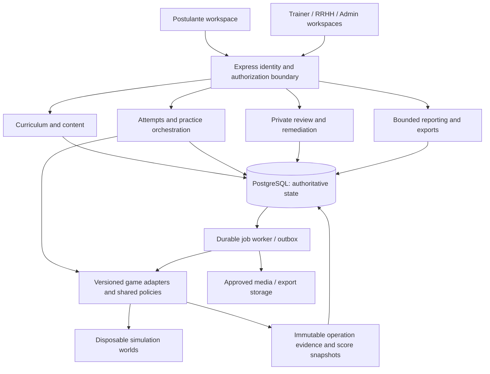

# Trez Training Hub: benchmark, architecture and delivery plan

Date: 2026-11-02 (America/Lima). Status: proposed architecture and executable backlog; business rules and deployment decisions remain subject to their existing approval boundaries.

Reviewed repository: `main`, `42e76777e911f3076abbe51e3e6b954df8813d15`. This deliverable changes documentation only. No dependency installation, application change, hosted access, migration, or deployment was performed for this research.

## 1. Architectural recommendation

Build an operator-readiness platform: approved instruction -> demonstration -> guided practice -> independent practice -> governed evaluation -> trainer review -> targeted remediation -> evidence of readiness for onsite training.

Retain React/Vite, Express, Supabase Auth/PostgreSQL and the existing simulator. Extend the modular monolith with a separately runnable durable worker. Reuse narrow components for editing and workflow logic; borrow product patterns from established LMS products. Keep operational rules, game adapters, authoritative evidence and scoring native to Trez.

The differentiating product is the link between realistic Backend/game actions and defensible readiness decisions. A generic course catalogue does not supply that link. The pilot should prove one complete Orion learning-to-assessment journey before broadening every module to every game.

This plan supplements the existing blueprint, development plan and trainer-review plan. It does not replace accepted ADRs or reinterpret their permissions. The old development plan's initial baseline predates the implemented Hub and tests; its historical missing-feature list must not be used as the current inventory.

## 2. Research method and confidence

Reviewed official GitHub repositories and vendor documentation on the research date. Queried GitHub's public repository API for stars, forks, push timestamps, archive status and detected license. This is a curated shortlist of relevant, adopted projects, not an exhaustive ranking of GitHub or proof of software quality. Stars measure attention; push activity can include automation or non-default branches. Neither proves secure releases, support quality or fit.

Commercial products are established reference platforms, not a verified sales/revenue league table. Vendor capability claims were used to identify patterns; no paid tenant, procurement quote, usability trial, independent market-share study or security assessment was performed. Feature availability depends on plan and contract. Repository metadata is a point-in-time observation; selected package versions, dependencies, release support and advisories must be verified during implementation spikes.

### Open-source shortlist

All ten repositories returned `archived=false`. Stars and dates below are the live API observations; dates use the UTC date of `pushed_at`. License labels are GitHub-detected identifiers, not a complete package/content license audit.

| Project / source | Stars | Last push | License | What it offers / fit decision |
|---|---:|---|---|---|
| [Open edX](https://github.com/openedx/openedx-platform) | 8,216 | 2026-11-02 | AGPL-3.0 | LMS plus Studio authoring. Learn from content publication and course delivery. Python and multiple backing services create substantial operating overhead for our existing stack; do not replace the Hub. |
| [Moodle](https://github.com/moodle/moodle) | 7,574 | 2026-10-30 | GPL-3.0 | Broad learning platform; its competency/learning-plan model is a useful reference. PHP application integration would introduce another runtime and learning system; benchmark rather than embed. |
| [Canvas LMS](https://github.com/instructure/canvas-lms) | 6,900 | 2026-04-30 | AGPL-3.0 | Course delivery with a strong review ecosystem. Borrow rubric/evidence review and performance-based path ideas. Public repo freshness needs investigation before any code adoption; it is not proof the commercial service stopped developing. |
| [Frappe LMS](https://github.com/frappe/lms) | 3,363 | 2026-11-02 | AGPL-3.0 | Courses/chapters/lessons, batches, quizzes, assignments, certificates. Useful compact administration model; its Frappe/Vue stack is not a drop-in React component. |
| [Tiptap](https://github.com/ueberdosis/tiptap) | 38,937 | 2026-11-02 | MIT core | Candidate for structured lesson authoring. Build Trez publication/version rules around the editor; core does not supply them. Paid extensions/services are separate decisions. |
| [XState](https://github.com/statelyai/xstate) | 30,403 | 2026-11-02 | MIT | Candidate for explicit exercise/evaluation transitions and model-based scenario coverage. Persistence, authorization and transaction safety remain our responsibility. |
| [BullMQ](https://github.com/taskforcesh/bullmq) | 9,566 | 2026-11-02 | MIT core | Durable-job alternative. Evaluate its selected backend/deployment requirements; a Redis deployment would add another service to operate. Do not run two queue systems. |
| [pg-boss](https://github.com/timgit/pg-boss) | 4,119 | 2026-11-02 | MIT | Preferred queue spike because we already use PostgreSQL. Supports scheduling/retries/dead letters. Verify supported database connection mode, privileges and hosting before adoption. Current README requires Node >=22.12, whereas our root still allows Node 20.19: runtime alignment is a prerequisite. |
| [Learning Locker](https://github.com/LearningLocker/learninglocker) | 585 | 2024-05-30 | GPL-3.0 | xAPI learning record store reference. Older public activity makes new production adoption unattractive without a maintained-support investigation. Keep canonical evidence in PostgreSQL; defer external LRS. |
| [Lumi H5P Node library](https://github.com/Lumieducation/H5P-Nodejs-library) | 207 | 2026-10-29 | GPL-3.0 | React/Express integration packages for H5P. Much smaller community than the libraries above, and integration/storage/endpoints are still required. Optional content spike only; not our authoritative practical scorer. |

Adoption order: evaluate Tiptap core for authoring; spike pg-boss for durable scheduling; use XState only where it materially simplifies transitions. Defer H5P until trainers demonstrate a content need that native activities cannot serve economically. No open-source LMS fork is proposed.

License/maintenance gate for every adopted package: pin a supported version, inspect its actual LICENSE and transitive packages, confirm intended distribution/hosting rights, check advisories and release cadence, record an owner and upgrade path, and test an adapter exit route. GPL/AGPL projects are not plug-in sources for unreviewed copy/paste. License implications of a specific integration require review; this research does not resolve them.

### Commercial patterns worth adopting

| Platform and official source | Verified offering used as reference | Proposed Trez improvement |
|---|---|---|
| [TalentLMS learning paths](https://help.talentlms.com/hc/en-us/articles/21712800370204-How-to-create-and-manage-Learning-Paths-in-TalentLMS) | Ordered courses, completion rules, group/branch assignment and path administration | Cohort enrolment, due dates, clear next action, explicit prerequisites and blockers. |
| [360Learning](https://website.360learning.com/product/learning-management-system/) | Built-in authoring, collaborative learning and feedback | Let operational experts propose lesson changes; require review before publication and track content feedback. |
| [Docebo](https://www.docebo.com/pricing/) | Skills framework, certification, reporting and multi-audience delivery, with hands-on labs among add-ons | Skill-level readiness and traceable evidence; tenant portals only after external demand exists. |
| [LearnUpon reporting](https://www.learnupon.com/platform/reporting/) | Filtered, exportable and scheduled reports, training histories and integrations | RRHH audit exports, cohort dashboards, report freshness/completeness and explicit data scope. |
| [Skillable](https://www.skillable.com/) and [scoring documentation](https://docs.skillable.com/docs/scoring) | Isolated practice environments and activity-based lab scoring | Treat actual action/state evidence as the basis of practical assessment; distinguish demonstrations, practice and exams. |
| [Canvas SpeedGrader](https://community.instructure.com/en/kb/articles/662775-what-is-speedgrader) and [Mastery Paths](https://community.instructure.com/en/kb/articles/660914) | Rubric/submission review with feedback; coursework based on prior performance | Operation-linked coaching, a review queue and targeted remediation. Keep feedback exposure within existing Trez role/evaluation rules. |

These are architectural inferences from the cited capabilities. We are not claiming vendor parity or copying their entire feature sets. A commercial LMS remains a future integration option if generic/compliance content grows substantially; it would not replace the simulator/evidence engine.

## 3. Current implementation and priority gaps

Current sources: `README.md`, `supabase/seed.sql`, Hub migrations, `backend/src/hub/*`, `frontend/src/components/hub/*`, `backend/src/engine/GameMaster.js`, `sessionRecovery.js`, `server.js`, and the 2026-11-02 trainer review plan/contract. No live hosted Hub inventory was performed here.

| Area | Present | Gap and priority |
|---|---|---|
| Identity / roles | Hub server-validated Auth, cookies/CSRF, database roles, Postulante management and RRHH reporting | P0: separately tested legacy simulator/trainer cutover; explicit subject/attempt/session link. Legacy name matching cannot establish identity. |
| Learning path | Modules, activities, prerequisites, enrolment, attempts, evidence/artifacts and progress already exist | P0: reconcile expanded curriculum and publish approved content. P1: cohorts, deadlines, resumption and useful blocker explanations. |
| Content management | Seeded provisional article/checklist/activity content and publication foundations | P1: trainer-facing authoring, preview, asset workflow, feedback and immutable published lesson versions. |
| Practical learning | Account Lab/search foundations; focused Orion refresh/add/withdraw activities | P0: approved account/reset rules and server-created durable artifacts. P1: Vblink/Golden Dragon capability parity. |
| Formal evaluation | Four draft evaluations; immutable published policy, attempt sets, reopening and result models | P0: approved answer keys, complete module mapping and adapter-derived evidence. Never trust browser correctness. |
| Review / coaching | Mistake filters, evidence explanations, explicitly linked audit timeline and stored-vs-reconstructed disclosure | P0: authoritative historical snapshots. P1: authenticated, versioned private notes and real follow-up evidence. |
| Scheduling | In-process generation timers plus restart restoration from persisted session deadlines | P0 for reliable assessments: durable jobs, leases/fencing and safe duplicate delivery. Restart restoration exists; multi-worker coordination is not established. |
| Analytics | Session/global statistics; global timing pagination recently corrected | P1: remaining directory/report/audit pagination, fixed report scope, completion coverage and skill/cohort views. |
| Operations | Local scripts, automated suites and migrations | P0: restore Docker/local DB gate; inventory actual hosted schema and deployment; test backup restore, migration recovery and observability. |
| Commercial readiness | Internal training roles and simulator assets | P2: repeatable onboarding and support/runbooks. Multi-tenancy, billing and marketplace features are future scope, not current capabilities. |

Current evidence limitations: the preceding status check could not reach Docker's Linux engine. Existing documents record 201 backend, 3 evidence-unit and 38 mocked-browser passes, plus lint/build; those suites were not rerun for this planning-only change. They do not prove current hosted deployment or real DB acceptance. Older notes saying hosted Supabase was never changed are historical: subsequent reconciliation migration and separately authorized cleanup are documented. Do not infer today's schema from those old notes.

## 4. Product scope and curriculum

Keep the ten existing learning topics and move the earlier Module 11 final scaffold into the expanded final evaluation. Use stable codes, separate display order and versioned prerequisites; do not renumber or overwrite historical completions in place.

| Existing learning topic | Required upgrade and acceptance |
|---|---|
| 1 Understanding the Work | Approved ecosystem/role/risk lesson, accessible demonstration and knowledge check; course completion alone is not practical competence. |
| 2 Complete Workflow Orientation | Teach the entire Backend-to-game-to-Backend sequence, history review, license/customer/account verification and safe decisions. Preserve Backend material omitted from partial daily-training references. |
| 3 Account Creation | One continuous approved Orion request -> Account ID Lab -> real simulator creation -> final Backend confirmation -> server-published password-free `CREATED_GAME_ACCOUNT` artifact. |
| 4 Search for Customer | Consume that same artifact; observe Ctrl+F, real paste, exact match and positive confirmation. Reject another attempt's artifact and stale/unlinked account. |
| 5 Refresh Balance | Verified Orion exercise plus demonstration of why refresh is needed; add other games only after each adapter's evidence contract passes. |
| 6 Add Credits | Guided and independent modes; reservation, pre-existing history, game action, Backend settlement and cancellation evidence. Never duplicate a pre-applied action. |
| 7 Withdraw Credits | Equivalent modes and evidence coverage with game/customer wallets kept distinct; safe retries and exactly-once business effects. |
| 8 Reset Password | Approved per-game policy and reset adapter; exact player verification, sanitized evidence and no password literal in retained reports. Hub login-password policy is a separate concern. |
| 9 Exceptional / Advanced | Approved cases for already-applied work, ambiguous matches, unavailable evidence, stale state and escalation. Each case needs an explicit safe expected outcome. |
| 10 Mixed Operations | Seeded, reproducible scenario plans with approved workload and difficulty; blend only verified capabilities and teach recovery as well as the happy path. |
| Earlier 11 final scaffold | Preserve history; migrate references into the expanded last readiness module with an explicit compatibility mapping. |

Preserve the four existing evaluation identities:

1. `checkpoint-game-platforms` — Game Platforms.
2. `checkpoint-operations` — Operations.
3. `checkpoint-movements-customer-experience` — Movements and Customer Experience.
4. `final-pretraining-readiness` — Final Pre-Training Readiness.

Important constraint: the first checkpoint's current database rule requires seven actions, including account creation, search, balance verification, add, withdraw, transaction-record review and reset/edit information. It cannot be placed directly after Modules 3–4. The other checkpoint mappings are incomplete. The content owner must reconcile all source material and action matrices before expanded numbering/order is published. A simple arithmetic 14-slot baseline is possible, but the complete content map may require additional units; do not force it into 14 modules or drop Backend/customer-experience coverage.

Preserve approved assessment policy: unlimited ordinary learning/practice; three attempts per formal set; 100% passing; default 20% theory/80% practical, adjustable only through authorized versioned settings; latest-result submission after attempts one/two; third-attempt automatic submission; TRAINER-only reopening with reason. Formal failure details remain private to authorized staff. Targeted learner feedback must not expose restricted formal evidence or effectively disclose answer keys. These evaluations establish readiness for onsite training, not independent job certification or replacement of onsite training.

Every learning topic should have approved objectives, a demonstration, guided practice, independent practice, evidence requirements and a remediation reference. Capabilities are reused across topics; content does not reimplement financial or account rules.

## 5. Target architecture and contracts

### Boundaries

- Identity: reuse Hub Auth, server roles and CSRF. Apply authorization to REST, realtime subscriptions, media and exports. Preserve TRAINER/RRHH global Postulante visibility for the current organization and existing write restrictions. A future tenant boundary would require a new design, not casual role filtering.
- Curriculum/content: course/module/activity versions, prerequisite graph, cohorts and assigned revision. Draft -> submitted -> published -> retired, with the existing two-person publication requirement. Prevent graph cycles and reject unavailable required capabilities before publication.
- Practice/orchestration: `demo`, `guided`, `independent` and `formal` are server-assigned modes. Free simulator remains ungraded. Formal creation requires a published evaluation, approved prerequisites and verified adapters; the browser cannot switch modes or declare completion.
- Game adapters: explicit capability matrix for create/search/balance/add/withdraw/history/reset. Commands accept subject/attempt/operation/policy-version/idempotency context. Output is a server-generated action result and sanitized evidence; unsupported actions fail closed. Game-specific terminology and wallet semantics stay inside their adapters.
- Evidence/scoring: record the original state needed for a decision, observed action and resulting state at execution time, with operation/attempt/session attribution, policy/scenario/adapter/scorer versions and server timestamps. Store final results as immutable snapshots. Do not recompute historical correctness from today's mutable balance.
- Review: private TRAINER-authored notes, revisions, issue codes, follow-up tasks and linked later verification. RRHH reads only its approved projection; permissions for new review fields must be explicitly mapped before exposure. A note never changes an original score. An annotation/correction is a new audited record.
- Reporting: stable cursor pagination, explicit filters/cutoff, completeness/error state, metric definitions and retained denominators. Long exports run as jobs and use protected expiring downloads. Distinguish live views from fixed-cutoff audit exports; a cutoff alone is insufficient if source rows remain mutable.

### State and persistence additions

Extend existing Hub tables rather than creating a second learning model. Proposed additions, subject to a schema diff: content-version/assets, cohort/membership, competency/evidence mappings, immutable operation snapshots, review/note revisions, remediation assignments, job/outbox records and readiness decisions. Existing policy, evidence-event, artifact, progress and attempt-set tables are reused.

Core invariants:

- Published versions are immutable; enrolments and attempts pin exact versions. A new curriculum version does not silently revoke or rewrite old completions.
- Unique `(attempt, operation, action/idempotency key)` constraints and atomic settlement prevent duplicate business effects. Queue delivery is assumed repeatable; no library alone guarantees exactly-once financial effects.
- Authoritative writes commit state, sanitized evidence and an outbox record together where transaction boundaries permit. Worker deliveries are deduplicated; cross-boundary actions have a reconciliation path.
- Artifact references are authorized by subject, attempt, lineage and allowed lifecycle. Never publish a browser-created account candidate as trusted evidence.
- Reopening, submission, expiry and worker actions use locked/conditional transitions with server time. Concurrent start/submit/reopen cannot allocate extra attempts.
- Late work after cancellation/expiry is rejected using durable state and lease/fencing checks. Restoring a worker cannot reset the exam clock.
- Retain required assessment evidence independently of disposable sandbox deletion. Two-year attempt-retention metadata already exists; new notes/media/export retention and deletion relationships still need explicit policy.
- Historical legacy rows without a trustworthy snapshot remain labeled legacy/unverified. Do not manufacture snapshots or merge identities from names.

### Reliability selection

ADR 0003 currently leaves the queue technology undecided. Recommend a time-boxed pg-boss spike, not automatic adoption: supported Node runtime, Supabase database privileges/schema, direct versus pooled connection behavior, connection budget, transaction/outbox integration, job recovery and hosting worker lifecycle must pass. Measure it against BullMQ only if those requirements fail or operational scale justifies another service. Record the result in a follow-up ADR; do not mark ADR 0003 accepted through this document.

The current restart-restoration path remains covered until the durable replacement proves equivalent behavior. Test two workers claiming the same attempt, crashes before/after settlement, delayed jobs, expired leases, queue outage and API restart. Define recovery objectives with the infrastructure owner and instrument queue lag/dead letters, scoring rejection, missing evidence and session recovery.

### Authoring, accessibility and media

Use a schema-based lesson model rendered by existing native activity components. Tiptap is a candidate editing surface for approved text/media blocks; sanitize output, restrict allowed nodes/URLs and validate on the server. Versioning/review stays in the Hub database. No arbitrary uploaded JavaScript or HTML execution.

Keep assets provider-neutral under ADR 0006: versioned metadata, approved private storage, short-lived delivery, upload limits, captions/transcripts/alt text and publication audit. Start with the existing storage ecosystem only after provider/privacy decisions are resolved. H5P, if adopted, runs behind a restricted content boundary and is used for interactive instruction, not as proof of operational correctness. Assess accessibility per content type.

Design for keyboard use, visible focus, screen-reader labels, reduced motion and understandable failure/retry states. Target WCAG 2.2 AA with manual keyboard/screen-reader checks as well as automation. Keep Postulante content English; staff English/Spanish, as already approved. Responsive lessons/reports are useful; desktop keyboard/game workflows must not imply that mobile assessment is supported without validation.

## 6. Build, reuse and defer decisions

| Decision | Direction | Revisit trigger |
|---|---|---|
| Whole LMS replacement | Keep native Hub; use Moodle/Open edX/Canvas/Frappe as references | Generic course/compliance demand exceeds native management needs; run an integration pilot before migration. |
| Authoring | Tiptap core spike plus native structured activities | Editor spike cannot meet accessibility/content-schema needs. |
| Queue | pg-boss first spike; retain a provider-neutral job contract | Hosting/privilege/connection tests fail or scale requires another backend. |
| Workflow state | Adopt XState only for complex flows with measured simplification | Plain server transitions remain clearer; library is optional. |
| Interactive content | Native activities initially; optional H5P later | Content team supplies a concrete high-value branching/video use case. |
| External interoperability | Versioned internal event schema now; xAPI/LTI/SCORM integrations later | An actual customer or content provider requires a named standard/version. Do not claim standards compliance from similar event fields. |
| AI | Later assistant for draft content and source-linked practice explanations | Approved content corpus, privacy, evaluation and cost controls exist. No autonomous formal grading, publication or restricted-answer access. |
| Multi-tenant SaaS | One-organization pilot first | First qualified external customer and documented data-isolation requirements. |
| Native apps, public leaderboards, ecommerce | Defer | Demonstrated learner/business value after readiness pilot. Avoid rewards that encourage rushing credit decisions. |

## 7. Delivery roadmap and exit gates

Planning range: approximately 14–20 calendar weeks for a pilot-quality Orion release with two full-time engineers, QA support and an available trainer/content owner; approximately 28–40 engineer-weeks. This is a provisional capacity envelope, not a commitment or quotation. Phase ranges below contain parallel work and are not additive; content approval, blocked local infrastructure and deployment access can extend elapsed time. Estimate again after Phase 0. Three-game parity and external SaaS scope are additional work.

| Phase | Scope / accountable lead | Exit gate |
|---|---|---|
| 0: Baseline and policy map, 1–2 weeks | Architect + content owner: restore isolated local stack; inventory current code/schema/deployments; reconcile full curriculum and checkpoint matrices; define pilot audience/concurrency, threat model and source-of-truth policy register | Traceability matrix covers all source requirements; open decisions have owners; existing full checks rerun on one commit; real DB/bootstrap/Auth gates pass; hosting constraints and pilot SLO targets recorded. |
| 1: Trusted identity and evidence, 2–3 weeks | Backend lead + QA: tested legacy cutover plan, explicit attempt/session link, immutable operation snapshots, stable adapter contract; queue spike | Unauthenticated/forged-role/CSRF/foreign-attempt access denied; score survives later balance/policy changes; idempotent retry creates one effect; legacy rows stay distinct. Cutover activated only through its existing controlled release gate. |
| 2: Complete Orion learning slice, 3–4 weeks | Full-stack lead + trainer: Modules 3–4 end to end; harden 5–7; approved reset and exception slice; lessons/demo/guided/independent modes | New account artifact survives reload/second client; search consumes the same player; history, settlement and redaction golden cases pass; trainer completes the workflow without engineering assistance. |
| 3: Authoring and coaching, 3–4 weeks, overlaps Phase 2 after identity foundation | Full-stack + content lead: draft/preview/two-person publish, approved media, cohorts/due dates, private notes/revisions, remediation and review inbox | Trainer publishes a revised lesson without a code release; past attempts keep the old revision; private notes survive reload and unauthorized reads fail; follow-up references actual later evidence. |
| 4: Governed evaluations and reliable runtime, 3–4 weeks | Backend lead + QA + content owner: approved question bank, exact checkpoint mappings, adapter evidence, worker/outbox and deterministic mixed scenarios | Forged correctness rejected; every required action/family covered; three-attempt and submit/reopen race tests pass; expiry/restart/duplicate-worker tests preserve deadlines/effects; all four evaluations publish only when complete. |
| 5: Pilot and release, 2–3 weeks | QA + operations + trainer/RRHH owners: complete bounded reports/exports, accessibility, load/recovery rehearsal, migration/rollback runbook and user acceptance | Frozen-commit full gates, real browser/DB journeys, backup restore, migration rehearsal, measured pilot load and signed operational/content acceptance. Pilot data validates usefulness before broad rollout. |
| 6: Expansion, separately estimated | Verified Vblink/Golden Dragon adapters; equivalent action/evidence coverage; optional standards integration | Per-game capability matrix and golden cases pass; no disabled game is advertised as assessment-ready. External portals wait for a separate tenant-isolation release. |

Critical dependency chain: approved rules + local DB -> trustworthy identity/evidence -> complete Orion artifact flow -> verified required capabilities + approved content map -> four formal evaluations -> pilot acceptance. Authoring and report usability can proceed while later adapter work continues, but assessment publication cannot bypass the chain.

### First implementation backlog

1. **HUB-001 / P0 / infrastructure:** repair Docker local-stack access and rerun baseline/local Auth/data gates. Acceptance: loopback-only verification passes on a recorded commit; no production test target.
2. **HUB-002 / P0 / content owner:** requirement -> lesson -> capability -> scenario -> evidence -> evaluation traceability matrix, including missing Backend/customer-experience topics. Acceptance: no orphan requirement; checkpoint numbering/prerequisites approved without dropping any seven-action requirement.
3. **HUB-003 / P0 / architect:** legacy route/realtime identity cutover specification, read/write visibility matrix and rollback switch. Acceptance: negative access tests plus explicit identity mapping; no name-derived links.
4. **HUB-004 / P0 / backend:** canonical evidence/score snapshot schema and characterization fixtures. Acceptance: changing current wallet/account/policy does not change finalized results; unavailable legacy evidence remains unavailable.
5. **HUB-005 / P0 / full-stack:** complete Module 3 artifact publication and Module 4 artifact consumption. Acceptance: one continuous request/account lineage, foreign/stale/forged artifact denial and second-client persistence.
6. **HUB-006 / P1 / backend:** durable-job proof of concept and ADR decision. Acceptance: runtime/connection constraints documented, crash/duplicate delivery tested, idempotent effects and bounded connection usage demonstrated.
7. **HUB-007 / P1 / frontend/content:** structured lesson authoring prototype with native renderers. Acceptance: sanitized server validation, preview, publication separation and pinned revision.
8. **HUB-008 / P1 / full-stack:** private review/note/remediation persistence after HUB-003/004. Acceptance: server authorship, version conflict detection, retention decision, authorized visibility and later evidence links.

Prioritize acceptance-complete vertical slices over finishing all screens first. Do not unlock future modules merely because their cards exist.

## 8. Verification and release strategy

- Preserve current unit/characterization/shared-rule/browser tests. Add high-value golden scenarios for each adapter/action and approved outcome; do not mirror implementation with trivial tests.
- Real isolated DB tests cover constraints, permissions, concurrency, transactional settlement, idempotency, artifact lineage, immutable scoring, note revisions and retention boundaries. Mocked browser passes are not persistence evidence.
- End-to-end journeys cover provision -> assign -> learn -> create/search same player -> operate -> complete evaluation -> submit/reopen -> trainer review -> RRHH audit, using the actual local Auth path.
- Fault injection covers API/worker restart, duplicate/out-of-order delivery, network loss after commit, expiration during action, stale version saves, missing evidence and partial export failures.
- Large-data fixtures exceed the known 1,000-row provider cap for reports/audits/directory and verify completeness or explicit failure. Export consistency is validated under concurrent writes.
- Security checks cover object-level authorization, role mutation denial, CSRF/origins, realtime room access, secret redaction, deactivation, protected media and export access. Preserve current role/password decisions unless explicitly revised by Trez.
- Load target is set in Phase 0 from expected pilot use, then tested at expected peak plus an agreed safety margin. Record p95 latency, connection use, queue lag, recovery time and error rate; do not invent a scalability claim from single-user runs.
- Release checklist includes actual hosted migration inventory, staging rehearsal, rollback/forward-recovery strategy, database backup restore, secrets/origins configuration, observability alerts, support owner and trainer acceptance. Health liveness alone is insufficient.

## 9. Outcomes, metrics and commercial direction

The initial customer is Trez's training operation. The likely future product is a specialized operator-readiness platform with realistic labs, versioned operational policies and auditable readiness reports. This is a positioning hypothesis, not validated market demand.

Measure readiness rather than clicks: time to independently perform a correct workflow; first-attempt checkpoint pass rate by cohort/policy version; unsafe duplicate-action rate; repeated mistake rate after remediation; trainer minutes per reviewed attempt; proportion of finalized results with complete attributable evidence; and onboarding-to-onsite-readiness time. Track accuracy separately from speed. Define denominators and treatment of abandoned, pending, unverified and reopened attempts before publishing metrics.

For the pilot, collect a baseline and agree improvement targets with trainers. No numerical improvement claim is justified yet. Candidate business success gate: trainers can onboard a cohort, identify blockers, coach an issue and verify later performance without engineering intervention; RRHH can retrieve the authorized evidence behind a readiness result.

Cost model for procurement: engineering/content/QA plus API hosting, worker hosting, database/backup/storage, media bandwidth, logs/monitoring and support. Estimate unit cost per active learner and per completed simulation using measured pilot usage. Commercial LMS comparisons require actual quotes at the same learner volume and module scope; no unsupported price or ROI claim is included.

If external sales are validated, add organization isolation and tenant-aware authorization across tables, storage, jobs, realtime, exports and audit; delegated administration, branding, provisioning, contractual support/retention, usage metering and billing follow. Begin with a paid discovery/pilot for a real customer before general SaaS investment. Do not confuse company/license identifiers inside a simulated operation with security tenants.

## 10. Decisions to resolve during Phase 0

| Decision | Proposed direction / owner |
|---|---|
| Launch scope | Orion-first internal pilot; Trez product owner confirms cohort size and launch date. |
| Curriculum and checkpoint placement | Content owner reconciles original Backend guide, broader blueprint and partial daily documents; preserves approved evaluation codes and seven-action first checkpoint. |
| Account/reset/exception policies | Named operational owner supplies approved per-game rules, examples and safe outcomes. |
| Runtime/queue/hosting | Engineering + infrastructure owner validate Node >=22.12 baseline and database/worker compatibility before queue selection. |
| Legacy identity cutover | Security/product owner follows ADR 0001 with explicit activation/rollback plan. |
| Content/media publication | Existing two-person policy remains; media provider/privacy/accessibility inputs resolved under ADR 0006. |
| Review retention and feedback | Product/privacy owner defines retention/deletion and what practice feedback can be shown without exposing formal failure evidence. |
| Pilot readiness sign-off | Trainer and RRHH owners define content/operational acceptance independently of test-suite success. |

The concrete next deliverable is Phase 0's verified baseline and curriculum/evidence traceability matrix, followed by the complete Orion Modules 3–4 slice. Installing an LMS or adding cosmetic dashboards does not resolve the current dependency chain.

## 11. Primary source register

All external sources accessed 2026-11-02. GitHub metrics were queried at `https://api.github.com/repos/{owner}/{repo}` for the ten repositories linked in section 2. Repository metadata may drift after this date.

- Open-source repositories: direct links and observed metadata in section 2; official documentation linked from their READMEs.
- [Moodle learning-plan competencies](https://docs.moodle.org/402/en/admin/tool/lp/learningplans): version-specific conceptual reference, not current API guidance.
- [Open edX platform overview](https://docs.openedx.org/en/latest/developers/concepts/platform_overview.html): LMS/Studio architecture context.
- [Tiptap editor overview](https://tiptap.dev/docs/editor/getting-started/overview): open-source core versus paid components.
- [H5P branching scenarios](https://help.h5p.com/hc/en-us/articles/7506761308957-Branching-Scenario-Guide) and [interactive video](https://h5p.com/content-types/interactive-video): optional content use cases.
- Commercial official sources appear beside each benchmark in section 2; vendor descriptions are feature claims, not independent outcome evidence.
- Internal requirements: `docs/TREZ_TRAINING_HUB_BLUEPRINT.md`, `docs/OPERATOR_GUIDE_REQUIREMENTS.md`, `docs/TREZ_TRAINING_HUB_DEVELOPMENT_PLAN.md`, accepted/proposed `docs/adr/0001` through `0007`, `docs/TRAINER_REVIEW_IMPROVEMENT_PLAN_2026-11-02.md`, and `docs/TRAINER_REVIEW_CONTRACT_2026-11-02.md`.

Original PPTX/DOCX reference files were not re-extracted for this research; their existing requirements extracts informed the plan. Phase 0 must confirm exact curriculum mapping with the source owner. Local implementation claims are tied to the reviewed commit; proposed features above are not claims of completed functionality.
